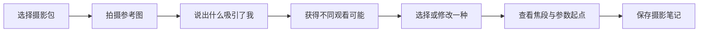

# 照见 MVP 产品需求文档

状态：草案，可进入原型

> 本文描述已经跑通的 MVP 核心体验。下一阶段产品范围与交付门槛见[照见 1.0 Skill 基础版开发范围](v1-skill-foundation-scope.md)。

## 1. 背景

现有摄影 App 大多强化拍摄控制、后期处理、滤镜或审美评分。照见聚焦拍摄前的观看过程：帮助用户从模糊吸引转向明确表达，再将表达转换为器材可实现的拍摄起点。

## 2. 核心体验

## 3. 功能需求

### FR-01 摄影包

- 用户可以创建、编辑和删除器材档案。
- 每个档案必须包含相机传感器尺寸或裁切系数。
- 镜头必须包含实际焦段范围和可用最大光圈。
- 系统必须拒绝不合理数值，例如焦段小于等于 0。

### FR-02 参考图

- 支持拍照与相册导入。
- 上传版本与原始版本分离；原图默认不上传。
- 用户可在发送前确认是否包含位置信息。

### FR-03 表达输入

- 支持文本、系统语音转文字和快速选项。
- 输入可以为空；为空时模型应从画面提出开放问题或初步可能。

### FR-04 场景分析

- 服务端必须返回符合 `scene-analysis.schema.json` 的 JSON。
- 分析结果必须区分“观察事实”“创作建议”“不确定性”。
- 系统先生成并校验画面理解，再基于结构化理解生成观看方向；第二阶段不重复接收图片。
- 当关键不确定性会直接改变关注对象或取舍时，系统只提出一个具体澄清问题，用户回答后再生成方向。
- 只在至少两种方向成立时返回 2～5 个不同且不排名的方向；第 3～5 个必须有新的具体画面关系或取舍，不足两种时明确返回没有足够可靠方案。
- 每个方向必须说明至少两个具体画面元素、它们的关系，以及该方向如何回应用户的吸引点。
- 每个方向提供 2～3 条可在现场执行并通过取景器核对的步骤。

### FR-05 观看建议

- 用户可以选择、收藏、忽略或请求另一种方向。
- 用户可以调整建议中的关注对象和情绪目标。
- 默认不展开技术参数。

### FR-06 器材实现

- 系统根据相机传感器和镜头范围换算实际焦段。
- 如果器材无法实现建议视角，必须提供最近可行方案，而不是虚构镜头。
- 参数引擎必须给出假设条件和调整方式。

### FR-07 摄影笔记

- 支持保存未完成笔记。
- 支持追加最终照片和试拍 EXIF。
- 用户可以导出自己的笔记数据；导出格式后续确定。

## 4. 非功能需求

- 核心离线能力：器材、焦段换算、参数引擎、笔记浏览。
- AI 请求超时后不能丢失用户输入。
- 模型供应商故障时可以切换或提示稍后重试。
- API 密钥不得存在于移动端。
- 云端参考图默认短期保存，策略见隐私文档。
- 中文是首发界面语言。

## 5. 关键指标

- 核心流程完成率。
- 用户保存建议的比例。
- 用户选择“换一种看法”的比例。
- 建议被认为有启发的比例。
- 模型虚构率、同质化率、JSON 失败率。
- 单次分析 P50/P95 延迟与成本。
- 用户在建议后实际保存最终照片的比例。

## 6. 验收边界

MVP 的目标不是证明 AI 能拍出“更好”的照片，而是证明用户认为：

1. App 帮助自己更明确地看见了什么。
2. 提供的可能性值得尝试。
3. 技术建议与自己的器材相符。
4. 整个过程没有夺走自己的决定权。
