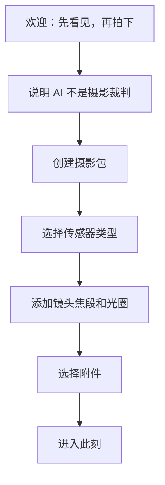
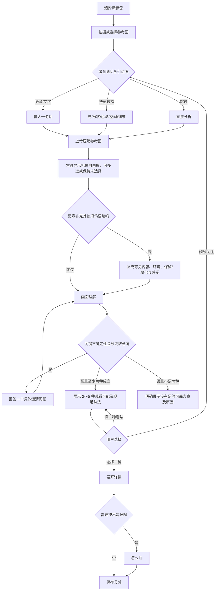
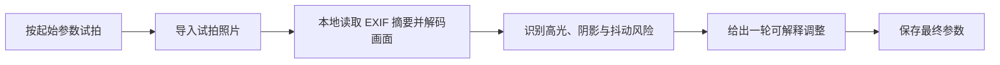

# 核心用户流程

## 流程 A：第一次使用

要求：

- 首次器材录入应控制在 2 分钟以内。
- 不强制用户从庞大器材目录搜索；允许“全画幅 + 24-70 F4”快速录入。
- 可跳过，使用“未知器材”只获取观看建议，不生成具体参数。

## 流程 B：一次现场观看

观看可能中的机位描述必须以参考图为相对基准，只表达“略低/相近/略高、偏左/相近/偏右、靠近/相近/退远”等可理解关系。不得把单张图无法确定的距离或角度写成精确米数、度数或导航指令。

机位自由度不是高级设置，必须在分析按钮之前常驻显示。未选择某个维度表示“不确认现场可以这样移动”，模型在该维度只能保持相近或未知；界面必须直接解释这一含义。

结果卡片先展示每个方向点名的画面元素、它们的关系和第一条现场试法，方向详情展示完整 2～3 步。步骤使用“尝试动作 → 取景器可见变化”的表达，让用户能现场验证；它们不是命令，用户可以跳过或拒绝。只在至少两种方向成立时展示 2～5 个方向，第 3～5 个必须包含新的具体元素关系或取舍；不足两种时展示没有可靠方案及其原因。

## 流程 C：查看“怎么拍”

1. 先显示建议的等效视角与用户器材的实际焦段。
2. 如果镜头可实现，显示焦段范围。
3. 如果不可实现，显示最近可行视角和影响。
4. 询问或复用现场约束：手持/三脚架、是否想表现运动。
5. 参数引擎输出适用方案。
6. 用户可以复制、保存或在相机上试拍。

## 流程 D：试拍校正（MVP+1）

## 流程 E：摄影笔记复盘

- 回看“当时什么吸引了我”。
- 对比参考图、选中方向和最终照片。
- 显示真实使用参数，不显示审美排名。
- 允许用户写下“我最终没有采用建议，因为……”。
- 将用户拒绝建议视为有效创作记录，而不是失败。

## 流程 F：账号与历史分析

1. 用户注册或登录个人账号。
2. 每次分析先建立属于该账号的任务，并复用该账号内相同的分析图对象。
3. 结果页仍按不排名的观看可能展示；完成后可以回到“我的分析”列表。
4. 选择一张参考图时，可以看到它过去的多次分析结果并分别打开，不自动宣布哪一次更好。
5. 用户删除任务后，该任务不再可访问；若图片没有其他任务引用，同时删除服务端分析图。

## 异常流程

### 无网络

- 保存参考图和输入为草稿。
- 提供焦段换算、参数计算与笔记。
- 允许网络恢复后手动发起分析。

### 模型超时

- 不自动重复扣费式调用超过一次。
- 保留现场输入。
- 显示“这次没有看清，我们可以稍后再试”，避免把失败归因于用户。

### 器材信息不足

- 仍提供观看建议。
- 技术页显示需要补充的最少信息，不阻断前面流程。
