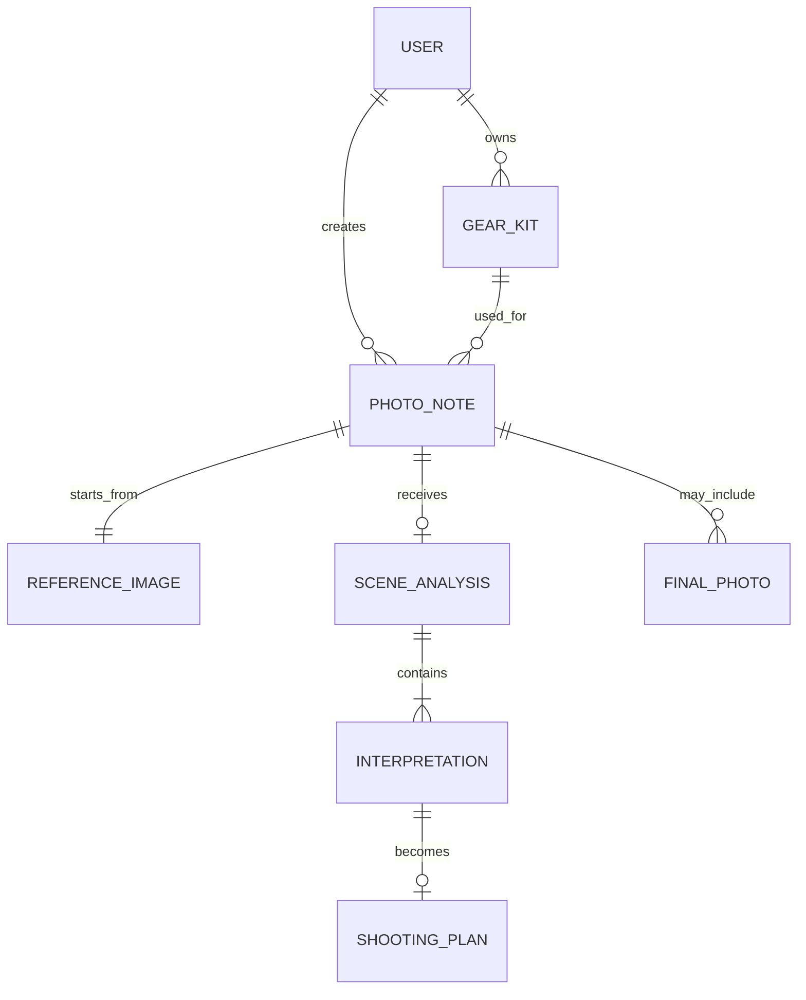

# 信息架构

## 顶层导航

MVP 采用两个主入口和一个账号内聚区：

1. **此刻**：开始一次现场观看。
2. **我的分析**：历史分析、同图多次结果与删除。
3. **个人中心**：个人资料、摄影包、摄影日记及后续设置入口。

## 页面树

```text
此刻
├── 选择摄影包
├── 拍摄/导入参考图
├── 什么吸引了我
├── 观看可能
│   ├── 方向详情
│   ├── 换一种看法
│   └── 修改关注对象
├── 怎么拍
│   ├── 焦段建议
│   ├── 稳妥手持
│   ├── 低噪点/三脚架
│   └── 表达性拍摄
└── 保存笔记

我的分析
├── 按参考图查看多次结果
├── 任务详情与模型用量
└── 删除任务与无引用分析图

个人中心
├── 个人资料
│   ├── 昵称
│   ├── 登录邮箱（只读）
│   └── 加入时间
├── 摄影包
│   ├── 新建与查看
│   ├── 设为此刻使用
│   └── 删除
├── 摄影日记
│   ├── 日记列表
│   ├── 观看方向与试拍方法
│   └── 删除
└── 设置（后续迭代）
    ├── 数据与隐私
    ├── 离线数据
    └── 导出/删除数据
```

## 信息优先级

### 第一层：当前感受

- 用户原话。
- 参考图。
- 关注对象。

### 第二层：观看可能

- 表达标题。
- 视觉感受。
- 保留与减少。
- 大致视角。

### 第三层：技术实现

- 实际焦段。
- 参数方案。
- 假设与风险。
- 调整方法。

技术信息不得抢占第一层和第二层的视觉层级。

## 数据对象关系


