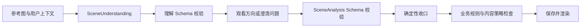

# 场景分析契约

## 目标

`SceneAnalysis` 是视觉模型与应用之间的稳定边界。应用不得直接渲染供应商返回的自由文本，也不得把未经校验的数值传给参数引擎。

画面理解契约见：[`schemas/scene-understanding.schema.json`](../../schemas/scene-understanding.schema.json)。

观看方向契约见：[`schemas/scene-analysis.schema.json`](../../schemas/scene-analysis.schema.json)。

## 三类内容必须分开

### 观察事实 `observations`

描述画面中可见的内容：

- 用户可能关注的对象。
- 对象之间可核验的遮挡、分离、延续、重复、方向、尺度、明暗、色彩、边缘或前后层叠关系。
- 前景、中景、背景关系。
- 可见光线和反差。
- 可见运动迹象。
- 无法确认的事项。

这些字段必须尽量可从参考图核验。

### 观看可能 `interpretations`

每项是一种创作方向，不是事实：

- 表达意图。
- 用于组织观看的 `visual_strategy`；前三个方向使用不同策略，但不据此排名。
- 具体画面元素、元素之间的可见关系，以及该关系为什么回应用户的吸引点。
- 一个同时点名至少两个具体元素、只比较一个可见变量的 `viewing_question`；它供用户在取景器中判断，不提供标准答案。
- 建议保留的画面关系。
- 可以减少的元素。
- 大致视角。
- 相对参考图的机位高度、左右关系、距离与画幅方向。
- 用户可在取景器中核对的可见结果。
- 2～3 条可执行的现场步骤；每步拆分为 `action`（怎么试）和 `check`（从取景器看什么）。
- 可能产生的视觉效果。
- 取舍与代价。

机位关系不是导航数据：模型只能使用相对枚举与自然语言解释，不得输出精确米数、角度或断言真实地形允许移动。用户声明不能改变的机位维度必须保持 `similar` 或 `unknown`。

### 技术观察 `technical_observations`

只提供参数引擎需要的场景约束：

- 是否存在运动。
- 动态范围是否偏高。
- 光线是否明显变化。
- 判断置信度。

模型不得在这里输出光圈、快门和 ISO。

## 坐标约定

若返回兴趣区域，使用归一化坐标：

```text
左上角为 (0, 0)
右下角为 (1, 1)
bbox = [x, y, width, height]
```

坐标只用于生成取景示意，不用于像素级测量和精确 AR 导航。

## 校验流程



确定性收口可以弱化不可证实的具体距离或角度、把越界取景框收回图片范围，并将夹带相机设置、未授权移动或没有点名该方向具体元素的单条现场步骤，替换为基于该方向元素关系的安全步骤。单条步骤的措辞问题不得阻断整次分析；收口也不得新增画面事实或替模型生成曝光参数。

业务规则包括：

- `outcome=clarification` 时必须提供一个问题且不得同时返回观看方向；`outcome=analysis` 时方向数量必须为 2～5；不足两种可靠方向时使用 `outcome=no_options`，提供原因与 1～4 条已检查依据，且不得同时返回观看方向。
- 每个方向必须包含至少两个具体画面元素、元素关系和与用户吸引点的联系。
- 每个方向的 `viewing_question` 必须至少提到两个 `grounding.elements`，并形成可在现场比较的问题；缺失或不具体时可由确定性逻辑基于已有元素和视觉策略补成，不得新增画面事实。
- 每项 `field_steps` 必须为 2～3 条，每条必须同时具有非空 `action` 和 `check`，不得把两者混成无法校验的抽象描述。
- `field_steps` 只描述取景、画幅、视角方向、画面边缘和元素关系，不得包含具体实际焦段、光圈、快门、ISO、白平衡、RAW、直方图或后期设置。
- 标题不得重复。
- 不同方向的 `view_width` 和取舍不能全部相同。
- 当用户允许改变机位时，不同方向的 `viewpoint` 不能全部相同；用户只能原地拍摄时，应通过画幅、视角与取舍形成差异。
- 不确定性不能混入观察事实。
- 等效焦段提示必须处于合理范围。
- 禁止出现构图分数与“最佳/错误/必须”等裁判式字段。
- 自动方向质量检查记录套话、固定构图公式、无依据象征叙事、Schema 字段泄漏、未点名具体元素的效果与代价。明确套话、公式、强加叙事和字段泄漏属于可修复的质量阻断，可使用唯一一次文本修复；具体性提醒用于回归和提示词迭代，不阻断本来成立的不同观看方式。所有维度不合成为审美分数，也不在用户界面排名。
- 进入质量检查前，应用会确定性翻译已知内部枚举、移除残留的下划线标签，并用第一阶段已有视觉关系补全 `grounding.relationship` 漏写的元素名称。这些处理不得新增画面事实，也不应消耗模型修复机会。
- 用户原话明确关注两个已识别对象之间的关系时，至少一个核心方向直接保留并回应这两个对象；其余方向只有在其他可见视觉关系成立时才能转换重心，并明确原关系会失去什么。
- 前三个方向的 `visual_strategy` 必须不同；只有两个方向时两者也必须不同，且不能把同一对元素机械改写为“重叠、分离、相切”冒充差异。
- Mock 输出必须把“没有分析图片”放入摘要和不确定性，不能复用看似针对当前图片的固定观察。

业务校验必须在一次遍历中收集全部违规原因，再统一交给唯一一次结构修复；不得遇到第一条问题就提前停止，导致修复候选保留其他已存在的违规。

## 版本策略

- 契约包含 `schema_version`。
- `3.0` 将方向数量提高为 4～5，并把 `field_steps` 设为每个方向的必填字段。
- `4.0` 增加两阶段画面理解、澄清分支和方向依据，并把方向数量改为质量优先的 3～5。
- `4.1` 在观察中增加 `visual_relations`，在方向中增加 `visual_strategy`，用于约束真正不同的视觉组织方式。
- `4.2` 为每个方向增加必填 `viewing_question`，把审美结论改造成摄影者可在现场比较的开放问题。
- `4.3` 将方向数量改为质量优先的 2～5，并增加 `no_options` 分支；不足两种可靠方向时明确告知没有方案，不允许凑数。
- 增加可选字段可保持小版本兼容。
- 删除字段、改枚举或改变语义必须升级主版本。
- App 必须能识别未知主版本并安全拒绝，而不是勉强渲染。

## 1.0 Skill 兼容映射

Skill 化不改变当前浏览器与分析 API 的请求/响应形状：

| 运行阶段 | Skill | 现有输入 | 现有输出 |
|---|---|---|---|
| 画面理解 | `observe-scene` | `SceneRequest`、分析图、账号内已核验摄影包 | `SceneUnderstanding 1.1` |
| 观看方向 | `composition-relations` | 已校验的 `SceneUnderstanding 1.1`、`SceneRequest`、摄影包 | `SceneAnalysis 4.3` |

兼容规则：

- 浏览器不能提交 Skill 内容、版本或活动状态；服务端从注册表选择活动版本。
- Skill ID、版本和内容哈希作为任务运行元数据单独保存，不加入 `SceneRequest`、`SceneUnderstanding` 或 `SceneAnalysis`，避免破坏现有客户端。
- 历史任务继续读取保存时的请求和结果，不因活动 Skill 更新而重新分析。
- `CreativeIntent 1.0` 只在用户选择观看方向后生成，关联分析任务和摄影日记；旧任务与旧日记不回填也能正常读取。
- `FinalPhotoObservation 0.1` 与 `PostProcessPlan 0.1` 是未来契约草案，不进入当前场景分析 Provider 调用。
- 未知 Skill 主版本由注册表安全拒绝；未知场景分析主版本继续由现有契约校验与客户端兼容逻辑拒绝。
