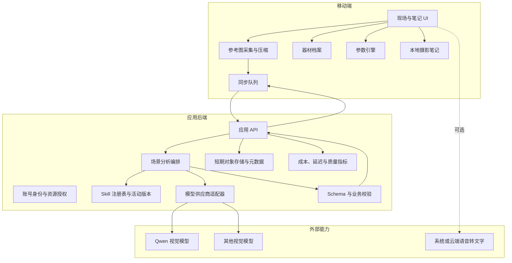

# 系统架构

## 架构目标

- 保持“艺术理解”和“技术计算”职责分离。
- 允许模型供应商切换。
- 户外无网络时仍保留核心摄影工具。
- 移动端不持有云模型密钥。
- 从 MVP 开始保留可评测、可审计的输入输出。

## 逻辑架构



## 关键边界

### ASP.NET Core 运行时控制面

`SceneAnalysisService`、`IVisionProvider`、契约校验器和基础设施服务位于 Minimal API 与具体 Provider 之间，负责可执行的控制流程，而不负责摄影判断：

```text
HTTP 输入与图片清理
→ Provider 首次调用
→ 输出标准化
→ Schema 与业务规则校验
→ 仅在可修复的模型输出错误时进行一次修复
→ 记录脱敏用量与运行结果
→ 返回已校验的业务结果
```

ASP.NET Core 控制面通过依赖注入接收身份解析器、Provider、幂等存储、每日额度、并发门、用量记录器和配置，因此 HTTP 端点不依赖供应商格式。结构化日志只记录请求 ID、Provider、模型、方向数量、图片字节数与尺寸、耗时、Token 和费用，不记录图片、Base64、用户原话、提示词、GPS、密钥或授权头。

`dotnet test Zhaojian.slnx` 使用 TestServer 和 Mock Provider 经过真实 multipart 路由、图片边界、请求白名单、幂等控制、Provider、契约校验与用量记录；它不访问外部模型、不读取 Qwen 密钥，也不替代真实照片评测。

### Skill 运行时控制面

`ISkillRegistry` 从发布制品的 `SkillModules` 读取 `skill.json`、说明、参考资料和正反例。启动时校验 Skill ID、语义版本、运行时兼容范围、资源路径、资源大小与规范化 SHA-256；任一版本失败时不会用半加载状态替换最后一个有效内存快照。

生命周期为 `draft → candidate → shadow → active → retired`。candidate 进入 shadow 时必须绑定通过的 candidate 阶段 `SkillEvaluationReport`；shadow 进入 active 时必须重新绑定包含独立 shadow 观察 ID 的 shadow 阶段报告，且该 ID 必须等于被评测候选报告的运行 ID。发布配置冻结当前评测数据集的 ID、版本与内容哈希。发布门禁逐项复核报告内容哈希、活动基线、Skill ID/版本/内容哈希、来源 ID/哈希格式、数据集、九个分维度指标及数值范围、36/12/12 分区、严重失败、成本、延迟和兼容性，不接受单独的 `passed` 布尔值。评测报告被修改、路径越界、缺字段或不符合当前迁移阶段时关闭失败，原活动版本保持不变。

活动版本、最近回滚版本、云端能力开关、单调递增 revision 和有限审计日志写入独立的 `skill-registry-state` 1.1 状态文件。写入采用同目录临时文件加原子替换；进程内变更由单写锁串行化，跨进程变更由状态文件旁的排他锁协调，并在持锁后重新加载最新磁盘状态，避免两个管理命令丢失 revision 或审计。读取使用完整快照，并校验审计事件唯一性、revision 连续性、动作允许的前后状态和发布动作的评测证明；活动与回滚指针不能相同，回滚目标必须仍是 shadow。每次 shadow、active、retire、rollback 和 kill switch 变更必须携带操作者与原因，审计记录命令、前后状态以及评测报告 ID/内容哈希。旧 1.0 状态可读，下一次变更会原子迁移到 1.1。仓库允许 `<skill_id>/skill.json` 的单版本布局，也允许 `<skill_id>/<skill_version>/skill.json` 的并存布局。

远程 API 只暴露当前账号可读的 `GET /v1/skills/status`，不提供发布写接口。本地维护者先用 `skill:evaluate` 产生不可变评测报告，再通过 `skill:shadow`、`skill:promote`、`skill:retire`、`skill:rollback` 和启停命令改变状态；所有写命令都使用具名参数，不能省略操作者或原因。`skill:audit` 只读取审计。kill switch 阻止新的分析入口，但不删除历史任务、器材档案或摄影笔记。

### AI Skill Trainer 离线控制面

AI Skill Trainer 不进入用户分析 API 和 `AnalysisTask` 数据表。它读取已验证的 60 图清单、固定分区与两个 Skill 内容快照，在本地 `.local/skill-training/<run_id>/` 保存：

- `run.json`：带规范化 SHA-256 的完整数据集引用、显式选择范围、角色级尝试、逐调用审计、恢复检查点和逐项终态；
- `role-outputs/<asset_id>/<role>.json`：真实模式下经过 Schema 与白名单校验的结构化角色结果和单次用量，不含图片、Base64、完整提示词或内部推理；
- `artifacts/*.json`：只含角色输出哈希、门禁证据和结构化改进候选，不含图片或内部推理；
- `report.json`：数据集与选择范围、Skill、模型、角色独立性、配置、计数、困难样例、Token/费用/延迟汇总、预算和可比较键。

检查点使用不可变快照、同目录临时文件与原子替换；恢复时必须匹配数据集、Skill、Trainer 协议和任何显式重传的运行参数。每个 `run_id` 只能由一个持锁进程写入；第二个运行进程关闭失败，活动运行的取消命令写入请求文件，由持锁进程在当前受约束调用收口后执行，避免取消与运行互相覆盖。进程异常遗留的锁只有在记录进程已经不存在时才可回收。运行根目录、制品目录和文件拒绝符号链接越界。生成角色不能决定自己的最终通过状态；批评、红队和确定性门禁的阻断证据会把样例送入隔离区。

Mock Provider 不读取图片，五角色输出只验证控制流程，`mock_only=true` 时契约强制 `eligible_for_training=false`。默认 CI 会运行完整 60 项 Mock，但不读取模型密钥、不访问网络，费用和 Provider 调用均为 0。

真实角色 Provider 与 Trainer 状态机隔离。当前 Qwen 适配器使用 DashScope OpenAI-compatible Chat Completions、关闭思考模式并强制单一 Function Calling；每个角色的 Function Schema 只暴露 `summary` 与该角色允许的一个结果数组，观察者和方向生成者还分别要求至少一条观察与一条方向。兼容接口若额外返回其他已知角色数组，适配器会按当前角色白名单丢弃它们并补齐统一空数组；未知字段、当前角色必需数组缺失或类型错误仍由 Schema 关闭失败。请求以 `max_pixels=2621440` 约束观察图输入，以 `max_completion_tokens=4096` 限制供应商侧最大输出，并在联网前拒绝超过 160000 字节的非图片请求载荷；只在观察者阶段上传本地清洗图，后续角色只读取已经校验的结构化结果。真实运行必须显式提供 `max_provider_calls`，并可用 `asset_ids` 从已验证的完整 60 图清单中选择小样本；选择顺序、三分区计数和哈希进入配置与可比较键。每次调用前同时检查调用次数上限并按 `max_cost_per_call` 取得费用租约：通过角色门禁的调用记为 `successful`；供应商已返回可信 Token、但内容未通过门禁的调用记为 `failed` 并按实际用量结算；缺少可信用量或进程崩溃遗留的调用才按最大单次费用记为 `uncertain`。候选 `artifact_type` 与最终训练制品使用同一枚举；旧版 `constraint`、`evaluation_case` 只归一为 `validator`，其他未知类型仍拒绝；多个候选复用同一证据时在制品引用层确定性去重。达到调用上限或可用预算不足时不再开始新角色，已落盘结果保持有效，剩余样例进入带明确停止原因的终态报告。运行文件保留每次调用的角色、尝试、开始/结束时间、延迟、用量与失败原因；报告按角色和全局汇总三类调用。模型实际账单仍需按对应供应商账单复核，报告字段是可追溯估算而非扣款凭证。

### Skill 离线评测与发布证据

`skill:evaluate` 只读取本地 Skill、冻结数据清单和基线/候选训练报告，不访问模型或网络。两个训练报告必须分别通过 Schema、内容哈希、业务计数、选择哈希和可比较键复算，并且覆盖同一 60 图与 36/12/12 分区。评测器按 JSON 解析、严重虚构、回应意图、方向差异、可见依据、澄清有效性、现场可执行性、器材可行性和裁判语言九个维度逐项比较，不产生审美总分；同时拦截新增严重失败、固定回归或保留集退化、成本与延迟越界、Skill 输入输出或运行时不兼容。

评测报告默认原子写入 Git 忽略的 `.local/skill-evaluations/`，只保存白名单元数据、版本、哈希、维度、分区、门禁和最小失败证据。candidate 阶段通过只设置 `eligible_for_shadow=true`；shadow 阶段必须使用一次独立候选运行，其 `run_id` 同时作为 `shadow_observation_id`，通过后才设置 `eligible_for_activation=true`。评测器不会调用注册表，也不会自动改变 Skill 状态。

### 个人创作记忆与全局候选隔离

个人记忆属于账号数据面，不进入 Skill 注册表或离线 Trainer：

```text
当前账号设备队列
→ 用户明确同意同步
→ 服务端按分析、方向和视觉策略复核白名单字段
→ FeedbackRecord
→ 至少两个不同任务的稳定信号
→ 当前账号 CreativePreferenceRecord

同一条已授权 FeedbackRecord
→ 去标识化 GlobalExperienceCandidateRecord
→ 隔离候选区
→ 不存在运行时读取入口
```

`PersonalizationService` 只接受枚举反馈、分析任务 ID、方向 ID、视觉策略和服务端重新取得的 Skill 快照；客户端不能上传 Skill 内容、图片、完整标题、自由文字或模型推理。撤回同意后新同步立即关闭失败；删除反馈会重新计算受影响偏好。账号注销通过数据库外键级联删除个人设置、反馈、偏好、创作意图和其对应的隔离候选。

### CreativeIntent 与摄影日记

`CreativeIntentService` 从当前账号已经完成且通过校验的分析任务、选中方向、任务 Skill 快照和任务创建时的摄影包快照确定性生成创作意图。前端只提交任务 ID 与方向 ID，不能拼装或伪造 Skill 来源。意图与分析任务采用可空来源关系：删除来源任务后，已保存意图继续保留原始 `source_analysis_id`、Skill 和摄影包快照；删除意图后，旧摄影日记回到明确的“没有可追溯创作意图”状态。

`FinalPhotoObservation` 与 `PostProcessPlan` 只作为 JSON Schema、示例与类型存在，不进入图像处理管线。运行时没有 RAW、曲线、HSL、蒙版、生成式编辑或不可逆像素写入能力。

### Beta 发布证据控制面

`beta:prepare` 在不访问外部模型的前提下运行 60 项 Mock、全量工程验证、固定评测、预算耗尽 Fixture、Skill 回滚/kill switch 和账号数据生命周期演练，然后打包带 SHA-256 的 API/Web 制品。`beta:report` 把命令、日志、制品、人工浏览器记录、单实例边界和真实模型摘要写入 Git 忽略的 `.local/beta-release/1.0.0-beta.1/evidence.json`。

3 图烟测、Mock 报告或单个 `passed` 字段不能让报告进入 `ready`。只有真实报告覆盖冻结 60 图、九维门禁全部通过、失败/不确定调用为零、预算没有提前停止且模型、提示词、Schema、Skill、数据集和计价版本可追溯时，`real_model_full60` 门禁才通过。工程 Beta 证据不替代商店、备案、支付、真实设备和公开运营的 Go/No-Go。

### 移动端本地

- 原图解码、方向纠正、JPEG 重新编码与 2 MiB 压缩。
- 原图和分析图预览、参考缩略图。
- 器材档案。
- 焦段与视角换算。
- 参数引擎。
- 摄影笔记草稿。
- 参考图压缩和 EXIF 清理。
- 离线队列。

### 应用后端

- ASP.NET Core 10 Minimal API、ProblemDetails、请求 ID、CORS、请求超时与健康检查。
- JPEG 2 MiB、文件头、尺寸、像素和字段白名单校验；不承担展示或常规压缩。
- ASP.NET Core Identity 账号、HttpOnly Cookie、CSRF 防护与任务/图片所有权授权。
- 账号/IP 限流、每日额度、分析并发保护、幂等控制与用量计量；任务记录持久化到数据库，由有界进程内队列调度并通过数据库条件更新原子认领，进程重启后周期恢复。每日额度、频率限制与用量聚合当前仍仅适用于单实例。
- 模型调用与重试。
- 结构化输出校验。
- 模型路由与成本记录。
- 去元数据分析图按账号持久化，删除最后一条关联任务时同步清除。
- 通过校验的结构化画面理解短时缓存；不缓存图片，修改观察事实时立即使用新缓存键。
- 账号级个人创作记忆、白名单反馈、隔离全局候选和 `CreativeIntent`；候选区不能被运行时 Skill 加载。
- 摄影日记可空关联 `CreativeIntent`，旧记录不补算、不重写。

### 模型供应商

- 场景观察。
- 用户意图理解。
- 观看可能生成。
- 结构化 JSON 输出。

## 为什么需要后端

即使首版功能很小，也不应让移动端直接调用模型：

- API 密钥会被提取。
- 无法统一配额与成本保护。
- 无法安全切换模型。
- 难以修复提示词和 Schema。
- 隐私删除策略无法集中执行。

## 存储策略

- 原始参考图默认仅在设备保存。
- 上传版本使用独立压缩副本。
- 云端只保存去元数据的分析图，不保存原图；账号可删除单条任务，最后一条关联任务删除时同步删除分析图。
- 场景分析 JSON、请求快照、活动 Skill 的 ID/版本/内容哈希快照、Provider 用量、计价版本、计费处置与费用估算写入账号任务明细；当前 SQLite 可备份，扩展为多实例时迁移 PostgreSQL。
- 用户启用同步前，不上传完整摄影笔记。

## 可观测性

每次分析记录：

- 匿名请求 ID。
- 逻辑模型角色与实际模型版本。
- 输入图片尺寸，不记录原图内容指纹用于跨用户追踪。
- Token、费用、延迟、重试次数。
- Schema 校验结果。
- 用户自愿反馈。
- Harness 版本、执行尝试、是否发生修复、各尝试耗时和最终结果摘要。
- 画面理解与方向生成的分阶段耗时，以及是否命中结构化理解缓存。

日志不得包含 API 密钥、完整图片 Base64、用户自由文本原文或精确 GPS，除非故障调试得到明确授权。

`GET /v1/operations/status` 会明确报告当前 SQLite、进程内 Channel、内存额度和 SQLite 图片存储，因此单实例阶段不会被界面描述为“多实例就绪”。分析幂等键已由数据库唯一约束保护；迁移点保持在任务队列、额度/频率限制、EF Core 数据边界和图片生命周期服务，不允许业务层直接调用 Redis、OSS 或供应商 SDK。
