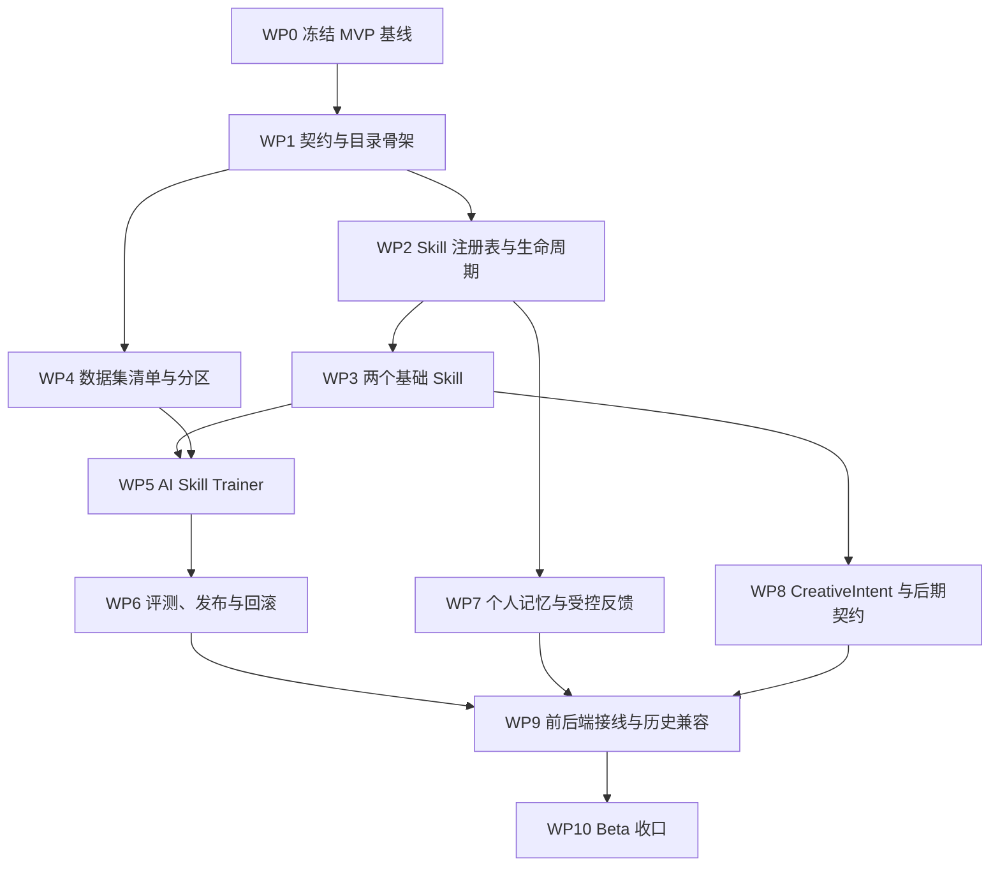

# 照见 1.0 Skill 基础版开发计划

状态：可执行
对应范围：[照见 1.0 Skill 基础版开发范围](../01-product/v1-skill-foundation-scope.md)
最后更新：2026-07-24

## 1. 交付目标

本计划把当前可运行 MVP 升级为第一版可训练、可版本化、可回滚的摄影 Agent。当前工程闭环继续工作，Skill 化不得以重写现有产品为代价。

计划中的“预训练”指离线生成和优化 Skill 的指令、参考知识、Few-shot、反例与校验器，交付物是版本化 Skill 制品，不是修改基础模型权重。

开发完成后应具备：

- 稳定的 ASP.NET Core/React MVP 基线。
- Provider 无关的 Skill 定义、注册表和生命周期。
- `observe-scene` 与 `composition-relations` 两个基础 Skill。
- 60 张真实摄影图片的数据清单与固定分区。
- 观察、生成、批评、红队、整理和评测组成的自动训练流水线。
- 候选 Skill 的 shadow、发布、停用和回滚。
- 可查看、删除、关闭和导出的个人创作记忆。
- 不能直接污染正式 Skill 的全局候选隔离区。
- `CreativeIntent` 与未来复盘/后期契约。
- `1.0.0-beta.1` 的自动化验证报告与可回滚制品。

## 2. 开发原则

1. **先冻结基线，再扩展架构。**
2. **先契约，后实现。**
3. **先 Mock 跑通，再显式运行真实模型。**
4. **先候选，再发布；任何自动结果都不能直接覆盖活动 Skill。**
5. **Skill 提供可能性，确定性工具计算技术结果。**
6. **个人偏好与全局经验物理隔离。**
7. **训练图片、授权信息和运行报告全程可追溯。**
8. **不建立人工逐图标注团队，但不让同一模型自问自答后直接判定通过。**
9. **不把后期契约扩大成自动修图实现。**
10. **每个工作包独立可验证、可回退。**

## 3. 总体依赖



`WP4` 可与 `WP2`、`WP3` 并行推进，但在 `WP5` 真实训练运行前必须完成数据来源和固定分区。

## 4. 计划中的目录与契约

建议增加以下结构；最终文件名可在实现时按 .NET 命名规范调整，但职责不得混合：

```text
skill-modules/
├── observe-scene/
│   ├── skill.json
│   ├── instructions.md
│   ├── references/
│   └── examples/
└── composition-relations/
    ├── skill.json
    ├── instructions.md
    ├── references/
    └── examples/

datasets/
└── photography-skill-v1/
    ├── manifest.json
    └── splits.json

schemas/
├── skill-definition.schema.json
├── skill-training-dataset.schema.json
├── skill-training-report.schema.json
├── creative-intent.schema.json
├── final-photo-observation.schema.json
└── post-process-plan.schema.json

src/Zhaojian.Api/
├── Skills/
├── Training/
└── Contracts/

tests/fixtures/
├── skills/
└── training/
```

训练图片本体不进入 Git。`datasets/` 只保存清单、分区、来源和内容哈希；本地图片位置通过安全配置或运行参数提供。

## 5. 工作包

### WP0：冻结当前 MVP 基线

目标：在 Skill 开发前形成可回退的工程起点。

任务：

- 复核当前大量未提交的 ASP.NET Core 迁移、账号、任务、数据保留和评测改动。
- 重复运行图片保留期相关测试，确认没有顺序依赖或偶发失败。
- 运行完整工程验证与固定评测。
- 刷新 Klari，并记录工作树未提交造成的 stale 告警。
- 将当前 MVP 形成独立提交；Skill 工作从后续提交开始。
- 保留当前单实例部署说明，不在本工作包引入 PostgreSQL/Redis。

完成标准：

```bash
npm run verify
npm run evaluate:fixed
npm run klari:refresh
npm run klari:validate
```

- 所有测试、构建和发布通过。
- 当前部署边界与 `/v1/operations/status` 一致。
- Git 能明确区分“MVP 基线”和后续 Skill 改动。

### WP1：契约与目录骨架

目标：先固定 Skill、训练报告与创作意图的稳定边界。

任务：

- 定义 `SkillDefinition` JSON Schema。
- 定义 `SkillTrainingDataset` 与 `SkillTrainingReport` JSON Schema。
- 定义 `CreativeIntent` JSON Schema。
- 为未来能力定义 `FinalPhotoObservation` 和 `PostProcessPlan` 草案。
- 添加 C# DTO、TypeScript 类型、示例和 Schema 测试。
- 定义主版本兼容与未知版本拒绝规则。
- 决定旧 `SceneRequest`、`SceneUnderstanding`、`SceneAnalysis` 与新契约的映射，不破坏现有 API。

完成标准：

- 所有新增 Schema 使用 Draft 2020-12。
- `additionalProperties` 默认关闭。
- 每个 Schema 至少有一个有效示例和一组无效边界测试。
- 旧任务无需迁移重算即可继续读取。

验证：

```bash
npm run validate:schema
npm test
dotnet test Zhaojian.slnx -v:minimal
```

### WP2：Skill 注册表与生命周期

目标：让运行时能够发现、校验、加载、追踪和回滚 Skill。

任务：

- 实现 `ISkillRegistry` 与文件/资源加载器。
- 校验 Skill ID、语义版本、内容哈希和运行时兼容范围。
- 实现 `draft`、`candidate`、`shadow`、`active`、`retired` 生命周期。
- 为每个活动 Skill 保存原子指针。
- 在分析任务中保存 Skill ID、版本、内容哈希和提示词版本快照。
- 提供只读 Skill 状态端点和受保护的本地管理命令。
- 实现停用云端 Skill 的 kill switch。
- 实现回滚到最近一个通过评测版本。

数据边界：

- 历史任务不随活动 Skill 变化重算。
- Skill 注册表不包含模型密钥。
- Skill 内容和训练图片分离。

完成标准：

- 注册重复版本、未知主版本、哈希不匹配和不兼容运行时时安全失败。
- 活动版本切换与回滚具有集成测试。
- Mock 环境能够切换候选与活动版本。

实施状态（2026-07-24）：WP2 已完成。分析任务保存 Skill ID、版本与内容哈希；`SkillDefinition` 中的 `instruction_version` 与全部模块资源共同进入内容哈希，因此不在任务行重复保存提示词正文。只读状态通过账号授权 API 暴露，状态变更仅允许本地命令执行。Provider 提示词迁移已在 WP3 完成。

### WP3：两个基础 Skill

目标：把现有两阶段提示词能力迁入可版本化 Skill，同时保持 API 行为兼容。

#### WP3.0 强制执行计划

- 服务端按任务类型生成不可跳过的 `observe-scene → composition-relations` 执行计划，模型和客户端不能替换阶段。
- 创建任务时保存两个活动 Skill 的版本与内容哈希；后台只按该快照解析完全相同的 Skill 制品，不回退到当前活动版本。
- 注册表加载时把指令、参考、正例和反例读取为不可变内容；执行期间不重新读取可被替换的文件。
- 任一 Skill 快照缺失、内容哈希不匹配、阶段契约不兼容或云端 Skill 被停用时关闭失败，不继续调用 Provider。

#### WP3.1 `observe-scene`

- 把画面观察指令、参考关系和反例移入 Skill 模块。
- 继续输出兼容 `SceneUnderstanding` 的结果。
- 添加人物身份推断、图片文字注入、反光误判光源和不确定性回归样例。
- Qwen 与 Mock 都通过同一 Skill 定义生成请求。

#### WP3.2 `composition-relations`

- 把观看方向指令、六类视觉策略和内容禁区移入 Skill 模块。
- 保持 `clarification`、`analysis`、`no_options` 三分支。
- 保持 2～5 个方向、开放观看问题、2～3 个现场步骤和取舍要求。
- 添加重复方向、三分法套话、无依据象征、危险机位和后期参数泄漏回归。

完成标准：

- HTTP 端点不包含 Skill 专属提示词。
- Provider Adapter 不依赖前端类型。
- Qwen 与 Mock 都消费服务端生成的同一份强制执行计划，且 Qwen 的阶段系统提示词来自任务快照对应的 Skill 制品。
- 观察缓存键包含 `observe-scene` 的 Skill ID、版本、指令版本和内容哈希，Skill 更新后不得复用旧观察。
- 核心 Skill 缺失、被替换或哈希不匹配时不会静默改用其他版本。
- 两个 Skill 均有 Mock fixture、契约测试和内容边界测试。
- 当前核心用户流程和历史结果 UI 不退化。

验证：

```bash
npm run verify
npm run evaluate:fixed
```

实施状态（2026-07-24）：WP3 已完成。服务端强制生成并恢复两阶段执行计划；注册表加载不可变 Skill 资源包并按任务快照精确解析；Qwen 与 Mock 共用阶段计划，Qwen 系统提示词不再保留 Skill 专属硬编码，观察缓存包含 Skill 版本与哈希。资源包总量、UTF-8、重复路径、目录符号链接和哈希不匹配均关闭失败。验证通过：Schema 31/31、Vitest 74/74、.NET 51/51、固定评测 2/2，Release publish 成功。

### WP4：60 图数据集清单与固定分区

目标：建立可复现、可追溯、不会被候选版本临时调整的数据基础。

任务：

- 按 25/15/10/10 类型分布寻找 60 张来源明确图片。
- 逐项记录来源、作者、许可、用途、署名、内容哈希和人物信息标记。
- 删除不必要 EXIF/GPS；原始来源记录与清理副本分离。
- 固定 36/12/12 训练、回归和保留分区。
- 为现有 12 个合成场景保留独立 fixture 身份，不计入 60 张真实图。
- 实现数据清单 Schema 校验、文件存在性检查、哈希检查和重复图片检测。
- 未取得训练许可的图片不得进入本地训练目录。

完成标准：

- 60 项清单完整，没有未知来源。
- 分区稳定且哈希可复现。
- 人物样例不包含身份标签或故事标签。
- 图片文件未进入 Git。

计划命令：

```bash
npm run dataset:validate
```

实施状态（2026-07-25）：WP4 已完成。仓库保存 60 项真实摄影来源清单和冻结分区，类别为 25/15/10/10，分区为 36/12/12；每项记录 Commons 来源页、下载地址、作者、开放许可、署名、来源 SHA-1、清洗副本 SHA-256、用途与人物信息标记。图片只保存在本地 `.assets/` 忽略目录，下载时移除 JPEG APP1–APP15 与 COM 元数据；验证器检查 Schema、清单哈希、数量、分区、来源与内容重复、许可与署名、人物标记、本地文件以及 Git 跟踪边界。`dataset:acquire` 只按冻结清单恢复，`dataset:seed` 才允许显式重建。人物环境样本已经过内容适配抽查，不包含身份或故事标签；Commons 元数据仅作为来源证据，不被表述为法律保证。验证通过：Schema 37/37、Vitest 86/86、.NET 52/52、固定评测 2/2，Release publish 成功；干净克隆模式的清单与分区离线校验也已通过。

### WP5：AI Skill Trainer

目标：在没有人工逐图标注团队的前提下，自动生成、批评、筛选和整理 Skill 训练伪标注。

任务：

- 建立训练运行、样例执行、角色尝试和结果报告模型。
- 实现观察者、方向生成者、批评者、红队检查者和整理者编排。
- 不让生成角色承担自己的最终通过判断。
- 为同模型不同角色与跨模型角色分别记录独立性等级。
- 实现超时、取消、有限重试、配额、并发和预算上限。
- 实现低置信度、模型分歧和未通过硬门禁样例的困难样例隔离。
- 默认使用 Mock 完整跑通 60 项清单流程。
- 真实模型运行必须显式开启，不能进入默认 CI。
- 训练报告只记录白名单元数据，不记录图片、Base64、完整用户文字或内部推理。

训练状态：

```text
queued
→ observing
→ generating
→ criticizing
→ red_teaming
→ curating
→ evaluating
→ completed | rejected | cancelled | failed
```

完成标准：

- Mock 训练可以中断、恢复、取消和重复运行。
- 同一数据集、Skill、模型与配置产生可比较的运行报告。
- 失败样例不会被静默丢弃。
- 预算超限会停止新任务而不破坏已有报告。

计划命令：

```bash
npm run skill:train:mock
npm run skill:train:cancel -- --run-id <运行 ID>
npm run skill:train:live -- \
  --allow-network \
  --provider qwen \
  --model <模型> \
  --asset-ids photo-v1-landscape-001,photo-v1-portrait-007,photo-v1-difficult-007 \
  --max-attempts 1 \
  --max-provider-calls 15 \
  --budget <显式预算> \
  --pricing-version <计价版本> \
  --pricing-effective-at <UTC 生效时间> \
  --input-per-million <输入 Token 单价> \
  --output-per-million <输出 Token 单价> \
  --max-cost-per-call <单次调用租约>
```

首批真实烟测冻结参数（历史基线；任何后续真实运行仍需开发者显式授权，不在默认验证中执行）：

```bash
npm run skill:train:live -- \
  --allow-network \
  --provider qwen \
  --model qwen3.7-plus-2026-05-26 \
  --asset-ids photo-v1-landscape-001,photo-v1-portrait-007,photo-v1-difficult-007 \
  --run-id run_live_qwen37plus_smoke_20260727_001 \
  --max-attempts 1 \
  --timeout-ms 120000 \
  --concurrency 1 \
  --max-provider-calls 15 \
  --budget 1.00 \
  --pricing-version aliyun-cn-beijing-qwen3.7-plus-2026-05-26-observed-2026-07-27 \
  --pricing-effective-at 2026-07-27T05:12:55Z \
  --input-per-million 2 \
  --output-per-million 8 \
  --max-cost-per-call 0.545
```

该方案固定华北 2（北京）模型快照及 2026-07-27 查询到的 0–256K 非思考模式公开价。适配器在联网前限制非图片请求载荷为 160000 字节，观察图固定 `max_pixels=2621440`，输出固定 `max_completion_tokens=4096`；考虑供应商声明的最多 10 Token 输出误差，单次保守费用上界为 `256000×2/1000000 + 4106×8/1000000 = 0.544848` 元，向上冻结为 0.545 元。1 元是本地派发硬停止线，不是供应商账单凭证；完成后仍需用实际 Token 和百炼账单交叉核对。API Key 只允许通过当前执行环境的服务端变量 `Model__Qwen__ApiKey` 提供，不写入命令、文档或版本库。

结构化方向契约 2.0.2 的真实评测不直接跳到 60 图，而由
`config/skill-live-evaluation-campaign.json` 固定为四个依赖阶段：

1. `smoke1`：1 图、5 次必需成功调用，最多 1 次受控修复；只验证供应商是否接受新契约。
2. `smoke3`：3 图、15 次必需成功调用，最多 2 次受控修复；覆盖风光、人物和困难场景。
3. `development12`：12 图、60 次必需成功调用，最多 6 次受控修复；覆盖风光、城市、人物和困难场景，仍不触碰新保留集。
4. `full60`：前三级全部通过后才首次暴露 v3 的 12 图新保留集；要求 300 次必需成功调用，最多 15 次已闭合受控修复，并交给 Beta 60 图硬门禁复核。

执行控制面：

```bash
npm run skill:live:plan
npm run skill:live:gate
npm run skill:live:verify -- --stage <阶段> --report .local/skill-training/<运行>/report.json
npm run skill:live:execute -- --stage <当前阶段> --allow-network
```

`skill:live:gate` 只读取四个冻结 `run_id` 的连续前置报告，拒绝外部报告、跳阶段和重复运行；每份报告必须匹配冻结资产、模型、契约、计价、预算和调用上限，且 `completed/passed`、九维门禁全通过、无失败或取消样例。逐调用审计还会验证 `run.json` 内容哈希、调用键唯一性、尝试连续性、每个资产五角色各有且仅有一次最终成功，以及失败/不确定调用与下一次成功尝试的一一闭合。

`skill:live:execute` 是唯一的分级真实评测执行入口：计划文件保持 `not_authorized` 时不会输出或执行联网命令；授权后仍需再次传入 `--allow-network`，执行器会强制官方 Base URL、安全映射本地密钥、固定 `run_id`、`fail-fast`、检查前置报告，并用前序实际费用加本阶段预算上限复核累计授权。任一样例在重试耗尽后会停止本阶段的新调用，后续阶段不会放行。四个阶段的本地预算上限同时构成累计授权上限，不能通过更换运行 ID 重复消费。

实施状态（2026-07-27）：WP5 已完成。默认 Mock 继续按 `observer → direction_generator → critic → red_team → curator → deterministic gate` 跑完整 60 项，得到 57 完成、3 隔离、0 丢失。供应商隔离的 Qwen 角色 Provider 只在观察者阶段使用本地清洗图，后续角色只接收已经校验的结构化结果；强制角色专用 Function Calling、统一请求/响应体超时和角色字段白名单，输出写入脱敏 `role-outputs/`，恢复时不重复已完成调用。兼容接口额外返回的其他已知角色数组在适配器边界丢弃；当前角色必需结果、未知字段和未知候选类型仍关闭失败。旧版 `constraint`、`evaluation_case` 只确定性归一为 `validator`，证据引用在聚合时确定性去重。真实命令要求联网授权、模型、密钥、显式资产列表或完整范围、Provider 调用次数上限、计价版本/生效时间、输入输出单价、总预算与单次租约全部显式提供。每次调用保存资产、角色、尝试、开始/结束时间、Token、费用、延迟和失败原因；有可信用量但未过门禁的调用记入 `failed_calls` 并按实际用量结算，缺少可信用量或崩溃遗留的调用才按最大单次费用计入 `uncertain_calls`。达到调用上限或预算不足时停止新工作并保留所有样例终态；同一 `run_id` 使用跨进程单写锁，活动取消由持锁进程收口。无网络 Live Fixture 已验证 3 图 15 次完整角色调用与调用上限停止。多轮真实烟测依次暴露并关闭角色字段漂移、偶发网络中断审计、候选重复证据和候选类型枚举漂移；门禁没有接纳无效结果。最终运行 `run_live_qwen37plus_smoke_20260727_006` 完成跨训练/回归/保留分区的 3 图 15 次真实调用：15 成功、0 失败、0 不确定，3 份制品通过合同与确定性门禁；输入 39671 Token、输出 4958 Token、估算费用 0.119006 元、总延迟 110412 ms、平均延迟 7361 ms、最大延迟 12978 ms。报告 `validation_status=passed`，真实候选仍强制为 `model_suggested` 且 `eligible_for_training=false`，不会直接进入活动 Skill。默认 CI 不读取密钥、不访问模型；下一步进入 WP6。

### WP6：评测、候选发布与回滚

目标：证明候选 Skill 可以安全替换活动版本，并能在退化时恢复。

任务：

- 实现分维度评测，不生成审美总分。
- 实现训练集报告、固定回归和保留集新旧对比。
- 保留每个失败的样例、规则、证据和版本。
- 实现 candidate → shadow → active 发布流程。
- 实现发布前兼容性、成本和延迟检查。
- 实现原子激活、kill switch 和回滚。
- 记录发布人/命令、时间、来源训练运行与评测报告。
- 默认 CI 只验证 Mock 与固定报告；真实模型报告由显式工作流生成。

发布阻断：

- 严重虚构新增。
- 危险机位、身份推断、隐私泄露或裁判语言越界。
- Schema 结构更好但内容依据更差。
- 无法读取历史任务。
- 无法回滚。
- 缺失来源、模型、Skill、提示词、Schema、数据集或成本版本。

候选阶段先生成离线评测证据，再由注册表复核该证据。评测命令要求基线和候选覆盖同一冻结 60 图与 36/12/12 分区，且训练配置可比较：

```bash
npm run skill:evaluate -- \
  --phase candidate \
  --baseline-report <基线-report.json> \
  --candidate-report <候选-report.json> \
  --baseline-skill <基线-skill.json> \
  --candidate-skill <候选-skill.json> \
  --dataset-manifest datasets/photography-skill-v3/manifest.json \
  --actor <操作者-id> \
  --reason "<至少 8 个字符的评测原因>"

npm run skill:shadow -- \
  --skill <skill-id> \
  --version <候选版本> \
  --report <candidate-评测报告.json> \
  --actor <操作者-id> \
  --reason "<进入 shadow 的原因>"
```

shadow 期间必须独立运行候选观察流程；把该候选报告的 `run_id` 作为 `--shadow-observation-id`，不能填写任意 ID，也不能复用 candidate 阶段报告直接激活：

```bash
npm run skill:evaluate -- \
  --phase shadow \
  --baseline-report <基线-report.json> \
  --candidate-report <shadow-report.json> \
  --baseline-skill <基线-skill.json> \
  --candidate-skill <候选-skill.json> \
  --dataset-manifest datasets/photography-skill-v3/manifest.json \
  --shadow-observation-id <观察-id> \
  --actor <操作者-id> \
  --reason "<shadow 复核原因>"

npm run skill:promote -- \
  --skill <skill-id> \
  --version <候选版本> \
  --report <shadow-评测报告.json> \
  --actor <操作者-id> \
  --reason "<激活原因>"

npm run skill:audit
npm run skill:rollback -- \
  --skill <skill-id> \
  --actor <操作者-id> \
  --reason "<回滚原因>"
```

评测器默认只读本地文件并把报告写入 `.local/skill-evaluations/`，不会访问模型、不会改变注册表，也不会把 WP5 的 `model_suggested` 制品自动升级成 Skill。成本、平均延迟和最大延迟相对增长门槛默认分别为 20%、20% 和 25%，需要调整时必须通过显式参数进入报告。

实施状态（2026-07-27）：WP6 已完成。训练报告升级为九个非审美维度，离线评测器严格复算报告 Schema、内容哈希、业务计数、选择哈希和可比较键，只接受同一冻结 60 图与 36/12/12 分区的新旧运行；逐项比较 JSON 解析、严重虚构、回应意图、方向差异、可见依据、澄清有效性、现场可执行性、器材可行性和裁判语言，并单独检查新增严重失败、历史合同、成本、平均/最大延迟和回滚准备。candidate 报告只能进入 shadow；shadow 报告的 `shadow_observation_id` 必须等于独立候选运行报告的 `run_id` 才能激活。注册表在发布时重新读取并复算报告内容哈希、活动基线、目标 Skill、冻结数据集 ID/版本/内容哈希、来源格式、九维指标与数值范围、36/12/12 分区、成本和延迟，不相信单独的 `passed` 字段；状态、revision 和带操作者/原因/命令/评测 ID/哈希的审计由同一次原子文件替换提交，跨进程排他锁会在变更前重载最新状态，读取时复核 revision 连续性和动作语义。报告篡改、手工重签伪造基线/指标/成本、任意 shadow ID、审计语义异常或阶段复用均关闭失败，活动版本保持不变。验证通过：Schema 60/60、Vitest 136/136、.NET 62/62、固定评测 2/2、Web 构建和 Release publish。生产注册表只读检查仍为两个 `1.0.0` 活动 Skill、revision 0、审计为空；本工作包没有把 WP5 候选自动发布。下一步进入 WP7。

### WP7：个人记忆与受控反馈

目标：让照见理解个人创作偏好，同时防止个人数据污染全局 Skill。

任务：

- 定义账号所有的 `CreativePreferenceRecord`、`FeedbackRecord` 和全局候选记录。
- 将现有浏览器本地枚举反馈升级为离线队列；登录后只在明确同意时同步白名单字段。
- 记录分析 ID、方向 ID、视觉策略、Skill ID/版本、反馈枚举和时间。
- 实现个人记忆查看、修改、删除、关闭和全部清空。
- 将个人记忆与账号导出、注销和配额统计整合。
- 不保存图片、完整标题、完整用户原话或模型内部推理。
- 个人偏好默认只影响当前账号。
- 全局候选进入隔离表，不能被运行时直接加载为活动 Skill。

完成标准：

- 用户 A 不能访问用户 B 的记忆或反馈。
- 撤回同意后停止新同步。
- 删除、导出和账号注销覆盖新增记录。
- 本地离线反馈在重新登录时不会串账号。
- 单次点击或停留时间不会生成稳定审美偏好。

实施状态（2026-07-28）：WP7 已完成。新增账号设置、白名单枚举反馈、结构化偏好和隔离全局候选；默认关闭记忆与同步，同意撤回后新同步关闭失败。服务端重新核对任务、方向、视觉策略和 Skill 快照，至少两个不同任务才形成偏好。个人中心支持查看、停用、删除和清空，账号导出/注销及任务删除覆盖新增记录；前端 IndexedDB 队列按账号隔离，未分区旧反馈不会被任一账号认领。集成测试覆盖跨账号访问、撤回同意、删除重建、清空、导出和注销级联。

### WP8：CreativeIntent 与后期契约

目标：为摄影复盘和后期思路建立语义桥梁，不实现自动修图。

任务：

- 从用户输入、已校验画面理解和选中方向生成 `CreativeIntent`。
- 保存来源分析、方向、Skill 版本和器材快照。
- 在摄影日记中关联 `CreativeIntent`，而不是复制无法追踪的自由文本。
- 定义 `FinalPhotoObservation` 草案：只描述最终照片可见事实。
- 定义 `PostProcessPlan` 草案：处理意图、目标区域、依据、预期变化、取舍、可逆性和不确定性。
- 增加示例与禁止字段测试，明确不能输出唯一正确后期答案。

完成标准：

- `CreativeIntent` 可保存、导出、删除和从历史任务读取。
- 旧摄影日记在缺少 `CreativeIntent` 时正常显示。
- `PostProcessPlan` 不包含实际像素修改或不可逆执行。
- 不新增 RAW、HSL、曲线或蒙版执行代码。

实施状态（2026-07-28）：WP8 已完成。`CreativeIntentService` 从已校验任务、选中方向、任务 Skill 快照和任务创建时的摄影包快照确定性生成意图；同一任务/方向幂等，支持列表、详情、删除、任务详情、摄影日记和账号导出。删除来源任务后保留契约快照，删除意图后旧日记回到可空兼容状态。`FinalPhotoObservation` 与 `PostProcessPlan` 示例、Schema 和禁止字段测试继续保持可见事实、多方案、取舍、可逆性和不确定性，不存在 RAW/HSL/曲线/蒙版/像素执行。

### WP9：前后端接线与历史兼容

目标：将 Skill 版本、个人记忆和 CreativeIntent 接入现有体验，不增加不必要操作。

任务：

- 前端继续提交当前用户意图和图片上下文，不提交可伪造的 Skill 内容。
- 服务端按活动注册表选择 Skill。
- 任务详情显示 Skill ID、版本和训练报告来源摘要。
- 个人中心增加“创作记忆”管理入口。
- 摄影日记读取和展示 `CreativeIntent` 摘要。
- 对旧任务、旧笔记和未知主版本提供明确兼容/拒绝路径。
- 完成加载、空状态、错误、取消、重试和离线队列状态。

完成标准：

- 核心分析流程不要求用户理解 Skill 技术概念。
- 旧数据不丢失、不被新版本重算。
- 未登录、切换账号、删除账号和离线恢复路径通过测试。
- 中文文案不把个性化表达成审美评分或系统命令。

实施状态（2026-07-28）：WP9 已完成。个人中心已接入记忆同意、偏好/反馈管理、隔离候选说明和 CreativeIntent 历史；摄影日记展示可追溯意图，任务历史展示 Skill ID/版本并对旧快照明确兼容。保存日记时先生成服务端意图，离线时保留当前账号待同步来源并恢复补传；重试会恢复分析图、原输入和机位自由度。Vitest、ASP.NET Core 集成测试和本地 Mock 真实浏览器闭环通过，浏览器控制台 0 条错误。

### WP10：Beta 收口

目标：形成 `1.0.0-beta.1` 可回滚制品与完整证据。

任务：

- 运行全量自动验证。
- 运行 60 图真实模型评测并归档脱敏报告。
- 检查自动门槛、成本、延迟、失败率和模型分歧。
- 重复验证图片保留、删除、导出、任务恢复和账号隔离。
- 验证训练预算上限、kill switch、Skill 回滚和云端分析关闭。
- 更新系统架构、数据模型、API、隐私、安全、评测、风险和发布文档。
- 生成 Beta 已知限制清单。
- 刷新并验证 Klari。

完成标准：

- 范围文档中的 Beta 条件全部有自动测试、报告或明确人工操作记录。
- 任何真实模型调用都能追溯到模型、提示词、Skill、Schema、数据集和预算。
- 单实例边界在 UI、状态端点和发布说明中一致。
- 发布制品可以回滚，且不影响用户访问本地数据。

验证：

```bash
npm run dataset:validate
npm run skill:validate
npm run skill:train:mock
npm run skill:evaluate
npm run verify
npm run evaluate:fixed
npm run klari:refresh
npm run klari:validate
```

实施状态（2026-07-29）：`1.0.0-beta.1` 的统一版本、`BetaReleaseEvidence`、无网络 60 项 Mock、预算/回滚/kill switch/账号数据生命周期演练、API/Web 制品、浏览器记录、已知限制和跨文档收口均已完成。历史真实运行推动对象传输、空弱化集合、策略派生和标签 Schema 依次收紧，最终冻结 Prompt/Schema 2.0.2 与 `photography-skill-v3@3.0.0`。四阶段 `smoke1 → smoke3 → development12 → full60` 连续通过：380/380 次 Provider 调用成功、0 失败、0 不确定、0 修复，费用 3.806872 元；其中 `full60` 完成 60/60 图片、300/300 调用和九个非审美维度。原 9.00 元授权累计支出 5.235520 元，剩余 3.764480 元。249 条历史失败/确定性排除记录重放通过，v3 holdout 12/12 已由正式全量运行评测并记入暴露账本。`npm run beta:verify -- --live-report .local/skill-training/run_live_contract202_full60_v3_20260729_001/report.json` 返回 `ready`，固定报告、运行审计、模型、契约、计价、预算和数据集快照全部一致。工程 Beta 的 WP0–WP10 已收口；公开发布仍受真实设备、商店、备案、隐私、支付和运营检查表约束。

## 6. 计划新增的 npm 命令

| 命令 | 默认联网 | 用途 |
|---|---:|---|
| `dataset:validate` | 否 | 校验来源清单、分区、哈希和重复项 |
| `skill:validate` | 否 | 校验 Skill 定义、版本、哈希、引用和 Schema |
| `skill:train:mock` | 否 | 用 Mock 跑完整训练状态机 |
| `skill:train:cancel` | 否 | 取消一个已有的离线训练运行并保存终态报告 |
| `skill:train:live` | 是 | 显式运行真实模型训练；要求选择范围、调用上限、计价快照与预算 |
| `skill:evaluate` | 否 | 复算同一冻结数据与配置的新旧报告，输出 candidate 或 shadow 阶段的九维评测证据 |
| `skill:audit` | 否 | 只读输出注册表 revision、版本状态与发布审计 |
| `skill:shadow` | 否 | 复核 candidate 评测报告后把指定候选进入 shadow |
| `skill:promote` | 否 | 复核带独立观察 ID 的 shadow 评测报告后原子激活候选 |
| `skill:rollback` | 否 | 记录操作者与原因并回滚到最近一个有效版本 |

`npm run verify` 不得隐式调用 `skill:train:live`。

## 7. 测试矩阵

| 层次 | 核心内容 | 默认运行 |
|---|---|---:|
| Schema | Skill、数据集、训练报告、CreativeIntent、后期草案 | 每次提交 |
| 单元测试 | 版本、哈希、状态机、分区、门禁、偏好提取 | 每次提交 |
| 集成测试 | Registry、Provider、任务、回滚、账号所有权 | 每次提交 |
| Mock E2E | 60 项训练状态机与失败恢复 | 候选提交 |
| 固定回归 | 12 合成场景和真实 12 图回归集 | 候选提交 |
| 保留集 | 新旧版本分维度对比 | 候选发布 |
| 真实模型 | 60 图运行、成本、延迟、分歧 | 显式运行 |
| 运行态 | 删除、恢复、预算、kill switch、回滚 | Beta 前 |

## 8. 数据迁移与兼容

- 新增数据库表必须通过 EF Core migration 管理。
- 旧 `AnalysisTaskRecord.RequestJson/ResultJson` 保持可读。
- 新字段优先可空；只有新任务保存 Skill 快照和 CreativeIntent。
- 旧摄影日记不批量生成 CreativeIntent。
- 新增个人记忆和反馈必须进入账号导出与注销删除。
- Skill 注册表内容与用户数据分开备份。
- 回滚代码版本时，不得因未知 Skill 版本破坏账号登录、摄影包和本地笔记。

## 9. 风险与控制

| 风险 | 控制 |
|---|---|
| 同一模型自我确认错误 | 独立角色、跨模型优先、确定性门禁、分歧隔离 |
| 训练数据污染 | 来源白名单、哈希、固定分区、候选隔离、无直接热更新 |
| 审美变窄 | 多方向、无总分、普通/困难样例、拒绝凑数 |
| 用户偏好被全局化 | 个人/全局存储隔离、明确同意、新版本发布 |
| Skill 版本破坏历史 | 任务保存快照、未知主版本拒绝、历史不重算 |
| 成本失控 | 真实训练显式开启、预算、并发门、取消和报告 |
| Provider 锁定 | Skill 契约与 Provider Adapter 分离 |
| 后期范围膨胀 | V1 只定义契约，不实现修图工具 |
| 图片权利不清 | 最小来源清单、未知许可拒绝、图片不入 Git |
| 偶发测试顺序问题 | 关键生命周期测试重复运行并检查隔离 |

## 10. 粗略迭代安排

以下是单人连续开发的工程估算，不包含等待外部授权、真实用户自然反馈或商业发布：

| 迭代 | 工作包 | 预计 |
|---|---|---:|
| 0 | WP0 基线冻结 | 2～3 天 |
| 1 | WP1 契约 + WP2 注册表 | 5～8 天 |
| 2 | WP3 两个基础 Skill | 5～8 天 |
| 3 | WP4 数据集 + WP5 Trainer Mock | 7～12 天 |
| 4 | WP5 真实运行 + WP6 发布回滚 | 6～10 天 |
| 5 | WP7 个人记忆 + WP8 CreativeIntent | 6～10 天 |
| 6 | WP9 接线 + WP10 Beta 收口 | 5～8 天 |

总工程量约 7～10 周。若数据来源寻找与许可核验并行，且不提前实现独立练习 UI、模型微调或自动修图，可控制在上述范围内。

## 11. 稳定版阶段

`1.0.0-beta.1` 之后不立即扩展新 Skill，先观察正常使用中自然产生的：

- 观看方向选择与修改。
- “值得试 / 太泛 / 依据不对”反馈。
- 摄影日记沉淀。
- 重复使用。
- 失败、延迟和成本。

当范围文档中的稳定版门槛成立后发布 `1.0.0`。这一阶段不建立专门人工逐图标注流程，也不允许用户数据直接改写活动 Skill。
